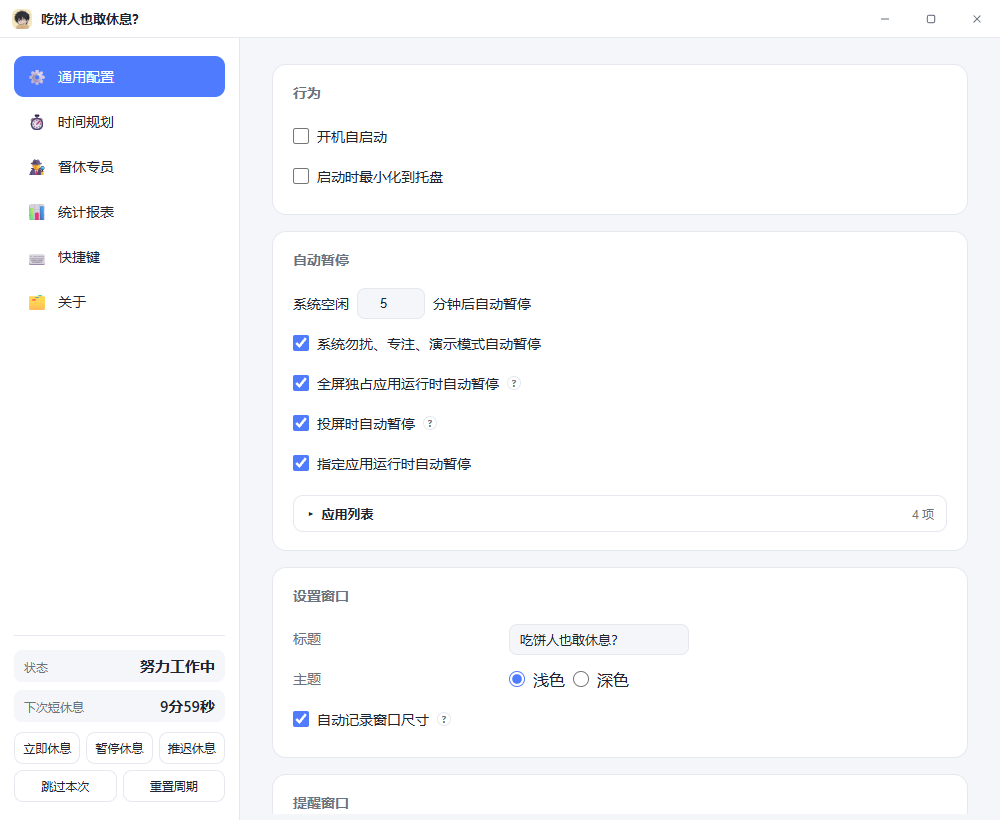

# 吃饼人也敢休息？

屏幕上弹一个"该休息了"的窗口，在你自己屏幕上是提醒，在视频会议的共享画面里是一场社交事故。

这个软件围绕这一件事做设计：**该弹的时候弹，不该被看见的时候不被看见。**

Windows 10 / 11 · 单文件绿色便携 · 免注册，数据全在本地


## 起因

Stretchly 我用了好几年，到现在也觉得它是同类里做得最好的一个。

问题在我自己身上。开视频会议共享屏幕，总忘记提前暂停提醒。到点它弹出来，一整个会议室的人都看着那个"该休息了"的窗口，我还在讲方案。不止一次。每次都想找个地缝。

后来就想，能不能让窗口照常弹，但共享出去的那份画面里没有它。

第一反应是检测到会议软件就自动暂停。进程名一查就知道，多简单。动手才发现不行：腾讯会议、Teams、Zoom、Webex 这类客户端打开基本就是在开会，可飞书、钉钉、企业微信、WeLink 也开会，它们日常主要是看消息、批流程、写文档，一天挂到黑。按"进程在不在"判断"是不是在开会"，结果是一整天都算开会，休息提醒永远不响。

把误判率压下去也不是不能做——查窗口标题、查进程有没有占着摄像头和麦克风，都是办法。但那是另一场和各家客户端的军备竞赛，人家每个版本都改，你得跟着改。

所以换了个方向。这个功能拆成两条独立的防线，一条管「别人看不见」，一条管「干脆不弹」：

- **窗口层**：不猜你在不在开会，让窗口本身只给你一个人看。
- **时机层**：真到了不该打断的场合（投屏、全屏、请勿打扰），干脆不弹。

代价我清楚：窗口还是照常弹，你自己还是看得见，还是得手动关掉。只是别人看不见了。对我来说这就够了——尴尬的从来不是我自己看见提醒，是别人看见。

---

## 防线一：让提醒窗从共享画面里消失

### 系统给的开关

Windows 10 2004 起，系统给每个窗口开了一个开关：

```c
SetWindowDisplayAffinity(hwnd, WDA_EXCLUDEFROMCAPTURE);  // 0x00000011
```

打过标记的窗口，在你自己屏幕上照常显示，能看能点；在任何走 Windows 官方捕获通路的程序眼里，这个位置是空的，露出底下的桌面。

它跟置顶、调透明度、挪到副屏不是一类东西。那几种做法窗口还在画面里，只是位置或样子变了。这条是让窗口从捕获结果里整个消失。

### 两个把它架空的坑

网上抱怨"设了标记却没生效"的帖子不少，我踩到其中两个，都挺隐蔽。

**一是 Chromium 的 DirectComposition 会把它架空。** Wails 提供的 `ContentProtectionEnabled` 底层就是调上面那个 API，但浏览器默认走 DirectComposition，画面实际在渲染进程的独立视觉树里上屏，不在宿主窗口的重绘表面上。亲和性设了个寂寞：回读是 `0x11`，看着完全成功，探针测出来窗口内容依然 **99.6% 可见**。在 `main.go` 里加上 `--disable-direct-composition`，让帧回落到窗口表面，同一份探针立刻变成 **0.00%**。这个开关是功能的前提，删掉就静默失效，不报错，也不黑屏，就是白设了。

**二是窗口得自己有重绘表面。** 半透明背景的窗口会被设成 `WS_EX_NOREDIRECTIONBITMAP`，没有重定向表面，亲和性对它不生效。所以上面那条要一起做，只改一处没用。

验证脚本是 `scripts/probe/probe_capture_guard.py`：把窗口底色染成纯品红，起无头服务，抓屏数窗口矩形里有多少品红像素。五类提醒窗口（短休息、长休息、自定义、提前提示、外卖）一个个跑，对照组约 95%，实验组全部 0.00%。

### 哪些会议软件看不见它

关键不在软件品牌，在它怎么取画面。Windows 上用户态读合成桌面的几条路，全都受这条亲和性约束：

| 采集通路 | 提醒窗口会被排除 |
|---|---|
| BitBlt（屏幕 DC） | 是 |
| DXGI Desktop Duplication | 是 |
| Windows.Graphics.Capture (WGC) | 是 |
| Magnification API（放大器、部分共享实现） | 是 |
| PrintWindow | 主流实现是（有"能绕过"的说法，未证实，会议软件也不用它） |
| NVIDIA NVFBC（老版 GeForce Experience 的接口） | 是 —— NVFBC 自己会查亲和性，遇到受保护窗口直接返回 `NVFBC_ERROR_PROTECTED_CONTENT` |

主流会议软件共享屏幕走的就是这几条路。所以下面这些，共享**整个屏幕**时提醒窗口不会进画面：

腾讯会议 · Microsoft Teams · Zoom · Webex · 飞书 · 钉钉 · 企业微信 · Google Meet（桌面端）· Discord · Slack

远程协助类（向日葵 / ToDesk / TeamViewer）同理。

有件事得说在前面：**我没有为了写这份说明去挨个开会实测**，上面是从采集通路推出来的结论。你拿其中一个试过、结果和这里不一样，告诉我。

一个反证：市面上有 AntiBlackScreen 这类"反黑屏"工具，专门对付共享时的黑屏保护。它们能活下来，本身就说明主流会议软件是老实遵守这条亲和性的，没兴趣绕。

### 什么时候不灵

**老系统上反而更糟。** Windows 10 2004（build 19041）以下不认这个新标记，Wails 会回退到旧的 `WDA_MONITOR`。这时候不是"看不见"，是共享画面里出现一块**黑矩形**，比不隐藏还显眼。`Win + R` 输入 `winver` 能看版本号，19041 以下建议直接关掉这个开关。

**采的是硬件信号，不是屏幕。** 采集卡、HDMI 融合器、会议室里那台把电脑 HDMI 当一路输入的硬件终端、直播采集盒。这类信号根本不经过 Windows 的捕获接口，亲和性够不着。

**走远程会话。** RDP、Azure Virtual Desktop、Windows 365。对方拿到的是协议流不是像素。微软专门给 AVD 做了个"屏幕捕获保护"策略，正好说明默认的窗口亲和性管不到远程协议。

**驱动层和注入层。** 自写驱动、DLL 注入、DWM 注入，这是作弊器和绕过工具的地盘。这条亲和性防的是规矩的捕获程序，不是铁了心要看的人。

另外两件小事。鼠标光标不算窗口内容，正好停在提醒窗口上时，共享画面里会飘着一个箭头。设置窗口没加保护，加了保护的只有休息、提前提示、外卖三类提醒窗口，因为设置窗口是你主动开来操作的，共享时一般不会开着——如果你习惯开着它，留意一下。

### 副作用：想截图也拍不到

亲和性不区分是谁在捕获，所以 `Win + Shift + S`、微信截图、Snipaste 拍不到提醒窗口，OBS 的显示器捕获、Xbox Game Bar 也一样。

想拍有办法：**通用配置 → 提醒窗口 → 把「共享屏幕时隐藏提醒窗口」关掉**。窗口就不带标记了，截图、录屏都正常，拍完记得开回去。

顺便说清这个开关该怎么用。它是默认开着的。你也可以平时关着、开会前再打开，但你多半会忘，而"会忘"正是这个软件存在的理由。我的做法是一直开着，真想截一张发给同事吐槽的时候，临时关一下再打开。

---

## 防线二：不该弹的时候，干脆不弹

第一道防线管"别人看不见"。可有些场合连你自己都不该被打断——在讲台上投屏、在共享文档、在开会。这时候弹出来再隐身也没意义，正确做法是根本不弹。

### 六种自动暂停

| 触发条件 | 说明 |
|---|---|
| **勿扰/专注** | 通知中心手按「请勿打扰」、Win10 专注助手「仅优先 / 仅闹钟」档位都会命中。读的是 Windows 真正的勿扰档位，开会前手一按，提醒立刻停。**「专注」与「勿扰」不是同一件事**：专注是带计时器的会话，按系统默认设置会自动打开请勿打扰，所以归这一条、没有单独的开关；若在「设置 > 系统 > 专注」里关掉了这个联动，专注会话就不改变任何系统状态，软件识别不到，请手动暂停 |
| **全屏/演示** | 放映 PPT、看视频、演示 Demo；D3D 独占全屏游戏、浏览器 F11 / 无边框覆盖整屏的窗口，以及 Windows 演示设置都算。与 Win+P 投影无关 |
| **复制投影** | Win+P 选复制，桌面被镜像到另一块屏——讲台标准姿势 |
| **无线投放** | Miracast / 无线适配器，挂成扩展模式也照样命中 |
| **指定应用在运行** | 自己配的 exe。默认内置腾讯会议、Teams、Zoom、Webex 四个"打开即开会"的客户端 |
| **长时间没动键鼠** | 人不在座位上 |

内置清单里只认那四个，不是漏了。飞书它们确实也能开会，但拿"进程在不在"当判据会大面积误伤，所以干脆不猜，留给你手动加。

触发时有三个动作，都做了：

1. **正在显示的窗口立刻收掉**——休息窗、提前提示、外卖窗，一个不留。不是淡出、不是变透明，是关掉。
2. **暂停期间到点的提醒直接跳过**，不攒着。攒着等恢复后一次性倒出来，比不弹更糟。
3. **恢复后倒计时重锚**，从"现在"重新算。暂停那半小时不该算进"你已经连续工作多久"。

### 哪些会自己恢复，哪些得你点

这是整个软件里我想得最久的一条。

**空闲、指定应用**这两种，条件消失就自动继续——人回来了、程序退了，说明你确实回到工位了，没什么好犹豫的。

**勿扰/专注、全屏/演示、复制投影、无线投放**这四种，条件消失**不自动恢复**，托盘会写一句「可以恢复」，等你点。

理由是很实际的：退出全屏不等于散会，可能是切出来看一眼消息，下一页还要接着放；投屏松一下还会接回去；勿扰是你自己按下去的，凭什么替你松开。条件消失只是"环境变了"，不等于"你回来了"。让软件替人判断这件事，误判的代价是"刚回到工作就弹一窗"，而多保留一会儿暂停几乎没成本。

「勿扰/专注」与「全屏/演示」在设置页是**两个互不相关的开关**：判据来自两套独立信号（前者读 Windows 的勿扰档位，后者读系统通知状态），各有一条暂停原因、一份「已手动恢复」记录。关掉其中一条不会顺带关掉另一条。全屏与演示本来也拆不开——系统只给一个互斥的通知状态值，不告诉你是浏览器全屏、独占游戏还是演示设置触发的，所以合成一条。

### 投屏、外接屏：认得出什么，认不出什么

Windows 能可靠拿到的只有两样东西：连接技术（HDMI / DP / VGA / Miracast…）和显示拓扑（几块桌面、是不是同一份画面）。系统里没有"对面那块是投影仪"这个字段，它只关心时序和分辨率。一台 60 寸电视、一台投影仪、一台显示器插上 HDMI，在系统里长得一模一样。

所以判据只有两条，而它们**必须拆成两个开关**：

| 判据 | 认不认 | 为什么 |
|---|---|---|
| 复制模式（两块屏共用一份画面） | 认 | 讲台最标准的接法 |
| 无线显示设备（Miracast / 无线适配器） | 认 | 它本身就是一种连接协议，不靠拓扑猜，基本不会误判 |
| 有线扩展、Win+P「仅第二屏幕」 | 不认 | 双屏办公的人太多，把"有两块屏"当投屏，这开关对他们等于永久失效 |
| 有线那头接的是显示器还是投影仪 | 不认 | EDID 厂商码识别率约七成，七成准的判据比没有更麻烦 |

两条判据可靠性差得远：无线那条看的是连接方式本身；复制模式在讲台上准确，但"笔记本接显示器图省事设成复制"也会命中。合成一个开关时只有"全信"或"全不信"两个选择。拆开之后各取所需——工位双屏的人关掉复制那条、留着无线；整天对着投影讲的人两条全开。默认都开。

还有一条出路：提醒窗口可以**只在勾选的屏幕上出现**。勾选是快照语义——出厂只勾主屏，接投影仪那一刻投影仪那行默认未勾，提醒不会自己跑上去。它只管"画在哪"，管不了"有没有"，所以和上面两个开关是配套的，不是替代关系。

最容易被当成 bug 的两行单独说清：

- **复制模式接投影仪**：下拉框里只有一行，你会觉得"我明明没勾投影仪，它还是弹上去了"。真相是系统里此刻只有一块桌面，一份画面被送到了两个口，应用层没有任何办法只让其中一路不画。唯一的拦法就是复制模式那个开关。
- **Win+P「仅第二屏幕」**：笔记本内屏关掉，系统里只剩外接那一路，和"台式机接一台显示器"完全一样，这是已知漏判。这种姿势要么提前从托盘点"暂停一段时间"，要么配一个暂停/恢复的全局快捷键。

### 定时暂停

进会议室前从托盘点一下：**30 分钟 / 1 小时 / 2 小时 / 到明天 0 点**，到点自己结束。暂停中再选一档是**改时长**，不是叠加。

到期不等于立刻恢复，还要过一遍上面那些条件：还接着投影、还在全屏/演示、勿扰/专注还开着、人不在座位上——保持暂停，等它们结束。托盘上会写正在等哪个。熬夜到零点还在用电脑则当场恢复。

「暂停休息」本身仍是无限暂停，一直等你手动恢复。暂停状态只在内存里，关机重启就结束——所以「到明天」只对晚上不关机（睡眠 / 休眠）的机器有意义。

### 暂停久了，提醒你一次

自动暂停超过一小时以后，每小时在右下角弹一张小卡片：「已暂停 1 小时」，带一个「恢复」按钮。不然很容易出现"我明明开了提醒，一整天一声没响"的困惑。

投屏、全屏/演示、勿扰/专注生效期间一次都不弹——那时的屏幕不是给你一个人看的。这几种刚结束的那一刻补一次，最短间隔 60 秒。

手动暂停不弹。那是你自己决定的，不需要软件来提醒你。

---

## 督休专员

如果说前两条防线解决的是"别让别人看见"，这一段解决的是"别让自己关掉它"。

只弹一句"该休息了"，人是会麻木的。所以我给它配了一个会催你的角色：**立绘站在窗口左边，眼睛跟着你的鼠标转；你还在动键盘，台词会往下走一层、人还会凑近。**

### 15 个内置，也能换成你自己的图

内置 15 位：秦始皇、神秘黑客、中尉军官、熊猫侠客、医生、经济学家、法官、体能教练、毒舌损友、野蛮女友、霸道总裁、温柔学姐、眼镜主管、画家、魔法师。

出场可以**固定**某一位、按**顺序轮换**，或者**随机**。

换成自己的图也简单：在设置页导入一张 PNG / JPG / WebP / GIF（透明底最好），起个名字，拖一下尺寸和位置，需要的话勾上水平翻转。它会落到 `supervisors/<名字>/` 下，跟着配置走，也能导出给同事。尺寸、位置、翻转是**每个专员各存各的**，不是全局一套。

### 说什么分两层，两层都能自己写

| 阶段 | 说什么 | 什么时候 |
|---|---|---|
| 第一阶段 · 劝 | **提醒内容**：短休息 / 长休息 / 外卖三类各有一个文案池，内置 13 / 6 / 6 条 | 窗口刚弹出 |
| 第二阶段 · 命令 | **专员自己的台词**：每个专员一份，医生有 34 条 | 你还在动键盘鼠标 |

提醒内容是普通条目，可增、可删、可禁用、可排序，随机取或按顺序取。想让它说自己的话——提醒喝水、提醒活动肩颈、提醒吃药——改这里就够了，不用碰立绘。

第二阶段那句是专员的口吻，存在 `supervisors/<专员>/meta.json` 里，跟立绘一起走。内置台词从"远眺几分钟"到"没有哪种坐姿能抵消久坐"，长短都有——长台词会触发字号自适应缩小，不会撑破对话框。

第二阶段的判断不看窗口有没有焦点——Go 侧轮询 `GetLastInputInfo`，你在**任何应用**里敲一下键都算。窗口会明显变脸：对话框底色转暗红、立绘凑近 8%、边缘起红色轮廓光并持续脉动。

这层设计是克制的：一旦你停手 6 秒，它就退回第一阶段，不继续加码。催促的目的是让人离开屏幕，不是跟人较劲。

### 自定义提醒

除了短休息、长休息、外卖这三类固定提醒，还能自己排"自定义提醒"：几点、哪些天、提醒什么文字。

自定义提醒里督休专员只作为背景立绘，不念自己的台词、也不进入第二阶段——因为这时你写的文字才是重点，角色抢先说话会盖掉它。

---

## 其他功能，一句话一个

- **两级休息**：短休息 / 长休息各管各的间隔与时长，默认 10 分钟 / 20 秒、20 分钟 / 5 分钟。
- **两种节奏**：按间隔倒计时，或按固定时刻（24 小时制、可配多条、按星期过滤）。
- **到点先敲门**：真正休息前 10 秒弹个小窗，可以立即休息、推迟、跳过、暂停计时。
- **外卖提醒**：饭点提醒下单，给三个按钮——已点好、不点了、推迟。
- **使用统计**：今日概览加周 / 月 / 季 / 年报表与历史明细。手动暂停和忙碌型自动暂停都算工作时间，只有长时间没动键鼠才算离开。
- **提示音**：四个内置音，也能导入自己的音乐。往 `sounds/` 里丢文件，它会自己发现，然后问你要不要用。
- **全局快捷键**：推迟、提前结束、暂停恢复、跳到下次休息，组合键自由录入。
- **外观**：明暗主题、背景色、透明度、窗口宽高比、全屏、置顶、显示在哪几块屏幕。
- **托盘常驻**：关窗不退出，开机自启动可选。

配置和统计都落在程序目录。不收集个人信息，也不上传任何东西。唯一会出门的动作是检查更新：一个 GET，除了一个固定的 User-Agent 什么都不带，连当前版本号都不发。



---

## 下载与安装

从 [Releases](https://gitee.com/null_719_5763/worker-rest/releases) 下载 `WorkerRest-portable.zip`，解压到任意目录，双击 `rest.exe`。

没有安装器，也不需要管理员权限，单文件加同目录数据，就是常说的绿色软件。首次启动会在 exe 旁边生成 `config/` 和 `data/`。

卸载就是删掉整个目录。唯一的目录外残留是注册表里的开机自启动项（只有勾过才有），所以删目录之前先运行包里的 `清除开机自启动项.bat`，它只删自己那一项，不碰别的软件。它不叫"卸载.bat"是有意的——它不删任何文件，叫卸载会让人以为删完目录就干净了。

更新检查默认开着，一天最多一次，也可以在「关于」页手动点。只走 https，下载完必须和清单里的 sha256 对上才装，对不上就换下一个源，全失败就这次不更新。

**暂停期间不做自动检查更新**：不管是手动暂停还是勿扰 / 全屏 / 投屏 / 应用占用自动暂停，当天排到的那次自动检查直接作废（错过就错过，明天还有）。手动入口一概不拦：点「检查更新」照常联网，点「立即更新」照常下载、替换、重启——暂停约束的是软件自己发起的动作，不是用户按下按钮这一刻的决定。

## 从源码跑起来

需要 Go **1.26+**（`go.mod` 里语言版本写的是 1.26.3）、[Wails v3](https://v3.wails.io/)（`v3.0.0`，`go mod download` 会拉下来）、Python **3.9+**（只有打包和验证脚本用）、Node.js + npm（只有渲染层探针用，Playwright 驱动本机 Edge）。

运行时要 Windows 10 / 11 加系统自带的 WebView2。Win11 必带，Win10 一般随 Windows Update 装好了，缺了首次启动会提示去哪装。

```powershell
git clone https://gitee.com/null_719_5763/worker-rest.git
cd worker-rest
go mod download

# 开发运行，直接起设置窗口
go run ./cmd/workerrest

# 构建 GUI 产物
go build -trimpath -o build/bin/rest.exe -ldflags "-H windowsgui -s -w" ./cmd/workerrest

# 打包便携版：构建 → 组装 exe + 立绘 + 提示音 → 打 zip → 校验内容
python scripts/build/make_portable.py
```

`-trimpath` 不是可选项。不加它，二进制里每个源文件的绝对路径（含构建机用户名）都留在 panic 栈里，`verify_portable.py` 有一条断言专门扫这个泄漏。

打包还有两个前置条件：当前提交上得有 git tag（版本号只认 tag，不认手填），工作树得干净。产物落在 `release/WorkerRest-<tag>/`。

关于 Python 有个坑：脚本用了类型注解和 f-string，**Python 2.7 会直接 `SyntaxError`**，看着像脚本写坏了，其实是解释器选错。真遇上了就双击 `scripts/build/打包.bat`，它按「固定 3.11 → `py -3` → `python`」的顺序挑。

常用命令收在 `Taskfile.yml` 里（`task dev` / `build` / `test` / `package` / `verify`）。

## 数据放在哪

一律"数据与程序同目录"，没有 `%APPDATA%`，也没有注册表配置：

```
rest.exe
config/settings.json     配置
config/sounds/           导入的提示音
data/stats.json          使用统计
sounds/                  内置提示音
supervisors/             督休专员（立绘、台词、每个专员的尺寸位置）
```

整目录拷走就是完整迁移，删掉就是彻底卸载。

## 关于这些代码

这个项目里绝大部分代码是 AI 生成的。这话我先说在前头。

我写代码十多年，但 Go 是现学的，Wails 也是第一次用。软件的想法、界面版式、交互细节，以及每个"为什么这么设计"的判断是我做的；把它们写成 Go 和 HTML/CSS/JS 的过程，主要交给 AI。

这有两个后果，都摆在这儿。

一是我逐行读过，也改得动，但不假装"每个字符都是我敲的"。所以仓库里堆了很重的测试：单元测试三百多个用例，渲染层和绑定层的探针合计一千多条断言，两条可访问性检查线，打包链上十几道门禁。AI 写的代码更需要机器去验，靠人眼看不过来。

二是关键决策仍然是人定的。窗口高度 857 是逐 2px 扫出来的，多 2px 就出滚动条；"必须加 `--disable-direct-composition`"是 99.6% 和 0.00% 两个数字对比出来的；更新链只认 https 且强制校验 sha256，是安全上的判断。这些不是 AI 想出来的，是踩了坑之后定下的规矩。

每条"为什么这么写"，记在 [docs/DEVELOPMENT.md](docs/DEVELOPMENT.md) 里。

## 还没做的，和暂时不打算做的

- **Linux 和 macOS**。代码结构不为难这事，`internal/` 下 7 个平台包早就成对写好了；卡住的是 Linux 缺一个系统接口——「共享时隐藏窗口」在 Linux 上没有对应机制，而它正是这个软件存在的理由。评估写在 [docs/LINUX-PORT-ASSESSMENT.md](docs/LINUX-PORT-ASSESSMENT.md)。macOS 有 `NSWindow.sharingType`，理论上能保住这个卖点，但没验证过。
- **云同步统计**。和"数据全在本地"的前提冲突。
- **"智能判断你是不是在开会"这条路，到此为止**。内置清单只认那四个打开即开会的客户端，其余的你手动指定 exe 就好。往下做要么误伤，要么变成跟各家版本赛跑，不值。

## 文档与反馈

| 文档 | 内容 |
|---|---|
| [使用手册](docs/manual/操作手册.html) | 界面总览、每项设置的含义、提醒窗口详解、常见问题 |
| [开发与实现说明](docs/DEVELOPMENT.md) | 构建链、目录结构、实现约定、探针矩阵、各处设计取舍的原因 |
| [docs/](docs/) | 架构重构设计、领域拆分、更新链设计、Linux 移植评估、各轮 QA 与审计报告 |

用出问题了、或者有哪个会议软件的表现和上面写的不一样，开个 [Issue](https://gitee.com/null_719_5763/worker-rest/issues) 就行，把 Windows 版本和会议软件版本带上。

## 许可证

本项目以 **MIT** 发布，正文见 [LICENSE](LICENSE)。可自由使用、修改、再分发，含商业用途，保留版权声明与许可全文即可。

第三方组件（Go 模块、标准库、前端内联库）的清单和许可全文由构建脚本从依赖里推导生成，随程序内嵌，在「关于 → 开源鸣谢」能读、能另存。

内置立绘和图标由 AI 生成，跟随本项目的 MIT 授权。历史人物是艺术化形象，不是史实原貌。

灵感来自 [Stretchly](https://github.com/hovancik/stretchly)。界面由 [Wails v3](https://v3.wails.io/) 承载，靠系统 WebView2 跑，没有 Electron，所以是十几 MB，不是那 180 MB。
